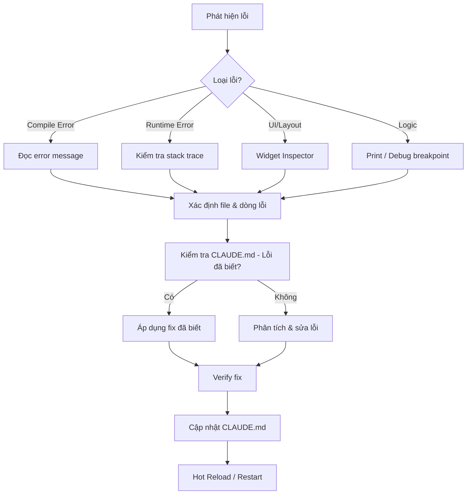

# ShopEasy - Dự án Thương mại Điện tử Flutter

> **MSSV**: 22T1020794
> **Học phần**: Lập trình ứng dụng cho các thiết bị di động
> **Giảng viên**: Nguyễn Dũng - Khoa CNTT, Trường ĐHKH, Đại học Huế
> **Trạng thái hiện tại**: Kiến trúc Feature-First (core/ + features/ cho ShopEasy + Labs độc lập)
> **Chạy trên**: Ungoogled Chromium / Chrome (web) — đã cấu hình tự động nhận diện
> **Cập nhật lần cuối**: 2026-10-30

---

## 📋 Mục lục

- [Tổng quan dự án](#-tổng-quan-dự-án)
- [Lộ trình xây dựng](#-lộ-trình-xây-dựng)
- [Tiến độ hiện tại](#-tiến-độ-hiện-tại)
- [Cấu trúc dự án](#-cấu-trúc-dự-án)
- [Quy tắc cho AI Assistant](#-quy-tắc-cho-ai-assistant)
- [Lỗi đã gặp và cách xử lý](#-lỗi-đã-gặp-và-cách-xử-lý)
- [Code giữ nguyên - KHÔNG ĐƯỢC THAY ĐỔI](#-code-giữ-nguyên---không-được-thay-đổi)
- [Yêu cầu đã thực hiện](#-yêu-cầu-đã-thực-hiện)
- [Cách tiếp cận debugging](#-cách-tiếp-cận-debugging)
- [Hướng dẫn mở rộng](#-hướng-dẫn-mở-rộng)
- [Ghi chú kỹ thuật](#-ghi-chú-kỹ-thuật)

---

## 🎯 Tổng quan dự án

**ShopEasy** là ứng dụng thương mại điện tử được xây dựng xuyên suốt **10 chương thực hành** (Chương 3 → Chương 12), thay vì các ví dụ rời rạc. Đây là **một ứng dụng duy nhất** được phát triển tích lũy qua từng chương.

### Tính năng sản phẩm cuối

| # | Tính năng | Trạng thái |
|---|-----------|------------|
| 1 | Trang chủ, danh mục, tìm kiếm sản phẩm | ⬜ Chưa bắt đầu |
| 2 | Chi tiết sản phẩm và đánh giá | ⬜ Chưa bắt đầu |
| 3 | Giỏ hàng, danh sách yêu thích | ⬜ Chưa bắt đầu |
| 4 | Đăng nhập bằng email và Google | ⬜ Chưa bắt đầu |
| 5 | Lịch sử đơn hàng, thông báo đẩy | ⬜ Chưa bắt đầu |
| 6 | Quét mã QR sản phẩm | ⬜ Chưa bắt đầu |

### Đánh giá kết quả học tập

| Thành phần | Trọng số | Hình thức |
|------------|----------|-----------|
| Chuyên cần và thái độ | 10% | Điểm danh, thảo luận trên lớp |
| Bài tập thực hành theo chương | 10% | Nộp bài qua GitHub sau mỗi chương |
| Kiểm tra giữa kỳ | 20% | Thực hành trên máy, Chương 1 đến 7 |
| **Đồ án cuối kỳ** | **60%** | **Ứng dụng Flutter hoàn chỉnh, bảo vệ trước hội đồng** |

> **⚠️ Mẹo quan trọng**: Đồ án nên là phiên bản mở rộng của ShopEasy hoặc ứng dụng tự đề xuất, được giảng viên duyệt trước tuần thứ 8.

---

## 🗺️ Lộ trình xây dựng

### Bản đồ nội dung

| Phần | Chương | Nội dung cốt lõi |
|------|--------|-------------------|
| **I. Nền tảng** | 1, 2 | Tổng quan thị trường và công nghệ di động; ngôn ngữ Dart |
| **II. Cơ bản Flutter** | 3, 4, 5 | Môi trường phát triển; hệ thống Widget; mô hình Layout |
| **III. Trạng thái và điều hướng** | 6, 7 | setState, Provider, Riverpod, BLoC; Navigator và GoRouter |
| **IV. Dữ liệu và mạng** | 8, 9 | REST API, Dio, Repository; SharedPreferences, SQLite, Hive |
| **V. Nâng cao** | 10, 11 | Firebase Auth, Firestore, FCM; camera, GPS, animation |
| **VI. Kiểm thử và phát hành** | 12 | Unit, Widget, Integration test; CI/CD; phát hành lên store |

### Chi tiết từng chương

| Chương | Tính năng được thêm vào | Dependencies dự kiến |
|--------|------------------------|----------------------|
| 3 | Tạo project, cấu trúc thư mục, splash screen, ThemeData | `flutter` (core) |
| 4 | ProductCard, màn hình Home, màn hình chi tiết sản phẩm | — |
| 5 | Bố cục responsive, grid nhiều cột, thanh tìm kiếm | — |
| 6 | Giỏ hàng và danh sách yêu thích với quản lý trạng thái | `provider` hoặc `riverpod` |
| 7 | AppShell với NavigationBar, GoRouter, deep linking | `go_router` |
| 8 | Tài sản phẩm từ REST API, infinite scroll, xử lý lỗi mạng | `dio`, `json_annotation` |
| 9 | Lưu giỏ hàng cục bộ, lịch sử xem gần đây với SQLite | `sqflite`, `shared_preferences` |
| 10 | Đăng nhập Firebase, đồng bộ dữ liệu Firestore thời gian thực | `firebase_auth`, `cloud_firestore` |
| 11 | Quét QR, ảnh Hero, skeleton loading, animation đơn hàng | `mobile_scanner`, `shimmer` |
| 12 | Bộ kiểm thử đầy đủ, pipeline CI/CD, đóng gói phát hành | `integration_test`, `flutter_test` |

---

## 📊 Tiến độ hiện tại

### Chương 3 - Khởi tạo dự án ✅ Hoàn thành

- [x] Tạo Flutter project (`shopeasy_22t1020794`)
- [x] Cấu trúc thư mục theo chuẩn Feature-First (`core/`, `features/` - Slide 57, 58)
- [x] Khai báo màu sắc dùng chung (`AppColors` - Slide 59)
- [x] Thực hành TH 20: Bảng màu riêng cho ShopEasy `_OMau` với `Wrap` (Slide 60)
- [x] Khai báo kích thước chuẩn `AppSizes` (Slide 61)
- [x] `ThemeData` tùy chỉnh (`AppTheme.lightTheme` - Slide 62)
- [x] Màn hình Splash Screen có animation Fade + Slide & auto navigate (Slide 63-65, 70)
- [x] Xóa template code mặc định

### Chương 4 → 12: ⬜ Chưa bắt đầu

---

## 📁 Cấu trúc dự án

### Cấu trúc hiện tại (Kiến trúc đa module: Menu Hub + ShopEasy + Bài tập)

Để vừa làm các bài tập thực hành theo tuần (Labs), vừa duy trì phát triển dự án lớn **ShopEasy (60% điểm đồ án)** trên cùng một project gọn nhẹ, mã nguồn được chia tách độc lập:

```
shopeasy_22t1020794/
├── .vscode/
│   ├── launch.json               ← Cấu hình chạy thẳng Ungoogled Chromium
│   └── settings.json             ← dart.env: CHROME_EXECUTABLE
├── assets/
│   └── wallpaper/                ← Thư viện ảnh wallpaper phục vụ bài tập
├── lib/
│   ├── main.dart                 ← Khởi chạy app, hỗ trợ kéo chuột web
│   ├── menu_page.dart            ← Hub Menu trung tâm (thông tin SV + điều hướng)
│   │
│   ├── core/                     ← [SHOPEASY] Code dùng chung toàn ứng dụng (Slide Trang 57)
│   │   ├── constants/            ← app_colors.dart, app_strings.dart, app_sizes.dart
│   │   ├── theme/                ← app_theme.dart
│   │   ├── utils/                ← Hàm tiện ích, extension methods
│   │   └── widgets/              ← Widget tái sử dụng toàn app
│   │
│   ├── features/                 ← [SHOPEASY] Các tính năng riêng biệt (Slide Trang 57)
│   │   ├── splash/screens/       ← Màn hình splash
│   │   ├── home/                 ← Trang chủ ShopEasy
│   │   │   ├── screens/          ← home_screen.dart
│   │   │   └── widgets/
│   │   ├── product/              ← models, screens, widgets
│   │   ├── cart/                 ← models, screens
│   │   └── auth/                 ← screens
│   │
│   ├── bai_tap_1/                ← [BÀI TẬP 1] Giữ nguyên độc lập
│   │   └── bai_tap_1_page.dart
│   ├── bai_tap_2/                ← [BÀI TẬP 2] Giữ nguyên độc lập
│   │   └── bai_tap_2_page.dart
│   └── bai_tap_2_1/              ← [BÀI TẬP 2.1] Giữ nguyên độc lập
│       └── bai_tap_2_1_page.dart
├── test/
├── pubspec.yaml                  ← carousel_slider ^5.1.2, assets/wallpaper/
├── analysis_options.yaml         ← flutter_lints
└── CLAUDE.md                     ← File tài liệu quy chuẩn dự án
```

### Cấu trúc chi tiết module ShopEasy (`lib/shopeasy/` - Khi hoàn thiện 10 chương)

```
lib/shopeasy/
├── shopeasy_app.dart             ← Config riêng cho ShopEasy (ThemeData, routes)
├── config/
│   ├── theme.dart                ← ColorScheme, typography
│   └── constants.dart            ← URL API, key
├── models/
│   ├── product.dart
│   ├── cart_item.dart
│   └── user.dart
├── screens/
│   ├── splash/
│   ├── home/
│   ├── product_detail/
│   ├── cart/
│   └── auth/
├── widgets/
│   ├── product_card.dart
│   └── search_bar.dart
└── services/
    ├── api_service.dart
    └── auth_service.dart
```

---

## 🤖 Quy tắc cho AI Assistant

### Quy tắc BẮT BUỘC

1. **LUÔN đọc file CLAUDE.md này** trước khi bắt đầu bất kỳ công việc nào trên dự án.
2. **KHÔNG bao giờ viết lại code đã ổn định** (xem mục "Code giữ nguyên").
3. **KHÔNG thêm dependencies** mà chương hiện tại chưa yêu cầu.
4. **Kiểm tra lỗi trước khi commit** bằng `flutter analyze`.
5. **Chạy app trên Chrome/Edge** (`flutter run -d chrome`) — KHÔNG dùng Android emulator để tiết kiệm tài nguyên máy.
6. **Cập nhật file CLAUDE.md** sau mỗi phiên làm việc với:
   - Các thay đổi đã thực hiện
   - Lỗi mới gặp phải
   - Tiến độ cập nhật
6. **Tuân thủ lộ trình chương**: Không nhảy chương. Mỗi chương xây dựng trên nền tảng của chương trước.
7. **Sử dụng Dart SDK ^3.13.2** - Không sử dụng API deprecated hoặc quá mới.

### Quy tắc code style

- Sử dụng `const` constructors khi có thể
- Sử dụng `.withValues(alpha: ...)` thay vì `.withOpacity(...)` để tránh cảnh báo deprecated
- Đặt tên file theo convention: `snake_case.dart`
- Đặt tên class theo convention: `PascalCase`
- Widget nên tách thành file riêng khi > 50 dòng
- Comment bằng tiếng Việt cho logic phức tạp
- Sử dụng `flutter_lints` rules
- Không in toàn bộ khối code dài ra cửa sổ chat (chỉ tóm tắt thay đổi và gắn link file)

### Bộ Skills & Plugins hỗ trợ phát triển (Đã kích hoạt)

AI Assistant ưu tiên vận dụng các bộ quy chuẩn kỹ năng (Skills) đã được cài đặt trên máy (`~/.gemini/config/skills/` liên kết từ `~/.agents/skills/`):

| Skill / Plugin | Nguồn | Mục đích áp dụng trong dự án ShopEasy |
|----------------|-------|---------------------------------------|
| **`flutter-expert`** | `agentic-awesome-skills` (v20.0.0) | Kiến trúc Flutter 3.x+, Dart 3, tối ưu hóa hiệu năng render, quản lý state (Provider/Riverpod) và đa nền tảng. |
| **`mobile-design`** | `agentic-awesome-skills` (v20.0.0) | Thiết kế chuẩn **Mobile-First & Touch-First**: vùng chạm ngón tay (min 48px), hệ thống màu sắc, typography và điều hướng di động (tránh bê nguyên tư duy web/desktop lên mobile). |
| **`ui-states`** | `agentic-awesome-skills` (v20.0.0) | Thiết kế đầy đủ các trạng thái giao diện thực tế: *Loading (Skeleton/Shimmer)*, *Empty (Giỏ hàng trống)*, *No Results (Không tìm thấy SP)*, *Error/Offline (Mất kết nối)*. |
| **`git-pushing`** | `agentic-awesome-skills` (v20.0.0) | Tự động hóa quy trình Git (`stage` → `commit` theo chuẩn Conventional Commits → `push`) kèm script `smart_commit.sh`. |
| **Plugin `flutter`** | Official Google Plugin (20 skills) | Hỗ trợ phân tích tĩnh, sửa lỗi layout overflow, responsive layout, JSON serialization, `go_router`, unit/widget test. |
| **Plugin `firebase`** | Official Google Plugin (10 skills) | Hỗ trợ tích hợp Firebase Auth, Cloud Firestore, và viết Security Rules ở Chương 10. |

### Quy tắc Hot Reload/Restart

- **Hot Reload**: Khi thay đổi UI widgets, `build` methods
- **Hot Restart**: Khi thay đổi `initState`, `main()`, global/static state
- **KHÔNG trigger**: Khi chỉ thay đổi comments, test files, files ngoài `lib/`

---

## 🐛 Lỗi đã gặp và cách xử lý

### Lỗi #001 - Template code lỗi cú pháp

- **Mô tả**: File `main.dart` mặc định chứa cú pháp không hợp lệ
- **Vị trí**: `lib/main.dart` dòng 31, 105
- **Chi tiết**:
  - Dòng 31: `ColorScheme: .fromSeed(seedColor: Colors.deepPurple)` → thiếu `ColorScheme` trước `.fromSeed`
  - Dòng 105: `mainAxisAlignment: .center` → thiếu `MainAxisAlignment` trước `.center`
- **Cách sửa**: Thêm tên class đầy đủ:
  ```dart
  // Dòng 31 - SỬA:
  colorScheme: ColorScheme.fromSeed(seedColor: Colors.deepPurple),
  
  // Dòng 105 - SỬA:
  mainAxisAlignment: MainAxisAlignment.center,
  ```
- **Trạng thái**: ✅ Đã xử lý triệt để trong `main.dart` mới.
- **Nguyên nhân gốc**: Code template mặc định viết theo cú pháp Dart ngắn chưa tương thích.

### Lỗi #002 - Flutter không nhận diện Ungoogled Chromium từ macOS GUI/IDE

- **Mô tả**: Khi người dùng chạy lệnh trong Terminal thì nhận diện được Chromium, nhưng trong danh sách thiết bị của VS Code / Antigravity IDE (Device Picker) thì không thấy `Chrome (web)` mà chỉ thấy `macOS (desktop)`.
- **Nguyên nhân gốc**: 
  1. Các ứng dụng macOS mở từ Dock/Finder không tự nạp biến môi trường từ `~/.zshrc`.
  2. Flutter SDK trên macOS mặc định tìm binary Google Chrome tại đường dẫn cứng: `/Applications/Google Chrome.app/Contents/MacOS/Google Chrome`.
- **Cách sửa**:
  1. Tạo symlink trỏ từ `/Applications/Google Chrome.app` sang `/Applications/Chromium.app`.
  2. Tạo symlink trong `Contents/MacOS/Google Chrome` trỏ sang `Chromium`.
  3. Thêm cấu hình `"dart.env": { "CHROME_EXECUTABLE": "/Applications/Chromium.app/Contents/MacOS/Chromium" }` trong `.vscode/settings.json` và `.vscode/launch.json`.
- **Trạng thái**: ✅ Đã sửa hoàn toàn, `flutter devices` và IDE tự động nhận diện `Chromium`.

### Lỗi #003 - Top-level executable code trong Dart

- **Mô tả**: Khi gõ bài tập hoặc code theo bài giảng, đặt các lệnh thực thi (`print`, vòng lặp `for`, điều kiện `if`) trực tiếp ở phạm vi ngoài cùng của file dẫn đến lỗi biên dịch đỏ gạch dưới.
- **Nguyên nhân gốc**: Trong ngôn ngữ Dart, ở top-level chỉ được phép khai báo (class, hàm, biến). Mọi câu lệnh thực thi phải nằm bên trong một hàm (như `main()` hoặc method trong class).
- **Cách sửa**: Bọc toàn bộ các lệnh thực thi vào trong `void main() { ... }` hoặc phương thức tương ứng.
- **Trạng thái**: ✅ Đã sửa và ghi nhớ.

---

## 🔒 Code giữ nguyên - KHÔNG ĐƯỢC THAY ĐỔI

> **⚠️ CẢNH BÁO**: Các file và cấu hình dưới đây đã được thiết lập đúng.
> AI KHÔNG ĐƯỢC viết lại, xóa, hoặc thay đổi trừ khi user YÊU CẦU TRỰC TIẾP.

### Cấu hình dự án

| File | Lý do giữ nguyên | Ghi chú |
|------|-------------------|---------|
| `pubspec.yaml` (metadata) | Tên project, SDK version đã chuẩn | Chỉ thêm dependencies khi chương yêu cầu |
| `analysis_options.yaml` | Đã cấu hình đúng với exclude paths | Có thể thêm rules, KHÔNG xóa rules |
| `.gitignore` | Cấu hình chuẩn Flutter | Không thay đổi |
| `android/`, `ios/` configs | Platform configs | Chỉ thay đổi khi thêm plugin native |

### Code đã ổn định (Cập nhật theo chương)

```
Chương 3 (khi hoàn thành):
  - [x] lib/core/constants/app_colors.dart (Slide Trang 59)
  - [x] lib/core/constants/app_strings.dart
  - [x] lib/core/constants/app_sizes.dart (Slide Trang 61)
  - [x] lib/core/theme/app_theme.dart (Slide Trang 62)
  - [x] lib/core/widgets/color_palette_page.dart (Slide Trang 60 - TH 20)
  - [x] lib/features/splash/screens/splash_screen.dart (Slide Trang 63-65, 70)

Chương 4 (khi hoàn thành):
  - [ ] lib/models/product.dart
  - [ ] lib/widgets/product_card.dart
  - [ ] lib/screens/home/home_screen.dart
  - [ ] lib/screens/product_detail/product_detail_screen.dart

(Sẽ được cập nhật sau mỗi chương)
```

---

## 📝 Yêu cầu đã thực hiện

### Phiên làm việc #1 - 2026-09-11

| # | Yêu cầu | Kết quả | Ghi chú |
|---|---------|---------|---------|
| 1 | Tạo file CLAUDE.md cho dự án | ✅ Hoàn thành | File này |

<!--
### Phiên làm việc #N - [NGÀY]
| # | Yêu cầu | Kết quả | Ghi chú |
|---|---------|---------|---------|
| 1 | ... | ... | ... |
-->

---

## 🔍 Cách tiếp cận debugging

### Quy trình debugging chuẩn



### Công cụ debugging

| Công cụ | Khi nào dùng | Command/Action |
|---------|-------------|----------------|
| `flutter analyze` | Kiểm tra static errors | `flutter analyze` |
| `flutter test` | Chạy unit/widget tests | `flutter test` |
| Dart MCP `get_runtime_errors` | Lấy runtime errors | MCP tool |
| Dart MCP `hot_reload` | Reload sau khi sửa UI | MCP tool |
| Dart MCP `hot_restart` | Restart sau khi sửa logic | MCP tool |
| Widget Inspector | Debug layout issues | MCP `widget_inspector` |
| `dart fix --apply` | Auto-fix lint issues | Terminal |

### Chiến lược thêm tính năng mới

1. **Đọc CLAUDE.md** → Xác nhận chương hiện tại, dependencies cho phép
2. **Tạo/cập nhật model** nếu cần dữ liệu mới
3. **Tạo service/repository** nếu cần logic mới
4. **Tạo/cập nhật widget** cho UI
5. **Tạo/cập nhật screen** để kết hợp widgets
6. **Cập nhật routes** nếu thêm screen mới
7. **Chạy `flutter analyze`** → Sửa lỗi
8. **Test** → Đảm bảo không break tính năng cũ
9. **Cập nhật CLAUDE.md** → Ghi nhận thay đổi

---

## 🚀 Hướng dẫn mở rộng

### Thêm section mới vào CLAUDE.md

Khi cần thêm thông tin mới, sử dụng template:

```markdown
## [Emoji] [Tên Section]

### [Sub-section nếu cần]

Nội dung...
```

### Checklist khi kết thúc mỗi phiên làm việc

- [ ] Cập nhật "Tiến độ hiện tại" 
- [ ] Thêm lỗi mới vào "Lỗi đã gặp"
- [ ] Cập nhật "Code giữ nguyên" nếu có file mới ổn định
- [ ] Thêm yêu cầu vào "Yêu cầu đã thực hiện"
- [ ] Cập nhật "Trạng thái hiện tại" ở đầu file
- [ ] Cập nhật "Cập nhật lần cuối" ở đầu file

### Quy ước đánh dấu trạng thái

| Icon | Ý nghĩa |
|------|---------|
| ⬜ | Chưa bắt đầu |
| ⏳ | Đang thực hiện |
| ✅ | Hoàn thành |
| ⚠️ | Có vấn đề / Cần xem lại |
| ❌ | Thất bại / Bị loại bỏ |
| 🔒 | Đã khóa - không thay đổi |

---

## 📎 Ghi chú kỹ thuật

### Môi trường phát triển

| Thông tin | Giá trị |
|-----------|---------|
| Flutter SDK | 3.47.2 (channel stable) |
| Dart SDK | ^3.13.2 (DevTools 2.60.0) |
| OS phát triển | macOS |
| IDE | VS Code (với Antigravity add-on) |
| **Thiết bị chạy** | **Ungoogled Chromium / Chrome (web)** — không dùng Android emulator |
| State Management (dự kiến) | Provider / Riverpod (Chương 6) |
| Routing (dự kiến) | GoRouter (Chương 7) |
| HTTP Client (dự kiến) | Dio (Chương 8) |
| Local DB (dự kiến) | SQLite (Chương 9) |
| Backend (dự kiến) | Firebase (Chương 10) |

### Lệnh chạy ứng dụng

```bash
# Chạy trên Chrome (MẶC ĐỊNH - ưu tiên dùng)
flutter run -d chrome

# Chạy trên Edge (thay thế nếu Chrome gặp lỗi)
flutter run -d edge

# Liệt kê thiết bị khả dụng
flutter devices

# Build web để kiểm tra production
flutter build web
```

> **⚠️ Lưu ý web platform**: Một số tính năng native (camera, QR scan ở Chương 11) sẽ cần
> plugin hỗ trợ web hoặc fallback UI. Sẽ xử lý khi đến chương tương ứng.

### Dependencies hiện tại

```yaml
dependencies:
  flutter: sdk
  cupertino_icons: ^1.0.8
  carousel_slider: ^5.1.2 # Dùng cho Bài tập 2 (Image slider demo)

dev_dependencies:
  flutter_test: sdk
  flutter_lints: ^6.0.0
```

### Dependencies theo lộ trình (KHÔNG thêm trước thời điểm)

| Chương | Package | Phiên bản (xác nhận khi thêm) |
|--------|---------|-------------------------------|
| 6 | `provider` hoặc `flutter_riverpod` | TBD |
| 7 | `go_router` | TBD |
| 8 | `dio`, `json_annotation`, `json_serializable` | TBD |
| 9 | `sqflite`, `shared_preferences`, `path` | TBD |
| 10 | `firebase_core`, `firebase_auth`, `cloud_firestore` | TBD |
| 11 | `mobile_scanner`, `shimmer` | TBD |
| 12 | `integration_test` | TBD |

---

## 📜 Lịch sử cuộc trò chuyện

### Session 1 - 2026-09-11 13:46

**Bối cảnh**: Bắt đầu dự án ShopEasy, user cung cấp 4 ảnh chụp từ PDF giới thiệu học phần.
**Yêu cầu**: Tạo file CLAUDE.md lưu thông tin dự án, lỗi, code giữ nguyên, yêu cầu trước đó.
**Kết quả**: Tạo CLAUDE.md toàn diện.

### Session 2 - 2026-10-09 14:15

**Bối cảnh**: Buổi học thực hành trên lớp: Bố cục Layout Flutter.
**Yêu cầu**: 
1. Code 2 file `main.dart` và `home_page.dart` theo ảnh bài giảng chiếu trên tivi.
2. Chèn ảnh Unsplash vào `home_page.dart`.
3. Hoàn thiện Bài tập 1: Layout hồ Oeschinen (Oeschinen Lake Campground) thay thế bằng ảnh thuyền buồm và thông tin sinh viên Nguyễn Ngọc Vĩ (22T1020794, K46D).
**Kết quả**: Hoàn thành chính xác giao diện theo mẫu bài giảng Flutter Layout Tutorial.

### Session 3 - 2026-10-11 17:22

**Bối cảnh**: User gỡ Edge và cài đặt Ungoogled Chromium trên macOS, gặp vấn đề IDE không nhận diện Chromium trong Device Picker.
**Yêu cầu**: Cấu hình để IDE và Flutter tự động chạy Ungoogled Chromium khi nhấn Run/Debug.
**Kết quả**: Tạo symlink chuẩn hệ thống macOS, cấu hình `.vscode/launch.json` và `.vscode/settings.json`.

### Session 4 - 2026-10-16 14:00

**Bối cảnh**: Làm Bài tập 2 (Complicated Image Slider Demo) và tái cấu trúc dự án để duy trì không gian đồ án ShopEasy xuyên suốt.
**Yêu cầu**:
1. Thiết lập trang Menu trung tâm (Hub) để điều hướng các bài tập và đồ án lớn.
2. Di chuyển Bài tập 1 vào `lib/bai_tap_1/`.
3. Code Bài tập 2 trong `lib/bai_tap_2/` bằng `carousel_slider`, tận dụng kho ảnh `/Users/crydamoure/Downloads/wallpaper`.
4. Tạo không gian riêng biệt cho dự án xuyên suốt ShopEasy tại `lib/shopeasy/` để phát triển song song với các bài tập thực hành.
5. Cập nhật và đồng bộ toàn bộ file `CLAUDE.md`.
**Kết quả**: Kiến trúc đa module hoạt động mượt mà, phân tích tĩnh `analyze_files` 0 lỗi.

### Session 5 - 2026-10-19 14:25

**Bối cảnh**: Tiếp tục bài giảng Chương 3 của thầy Nguyễn Dũng (Slide 57, 58, 59) và sửa cảnh báo `.withOpacity()`.
**Yêu cầu**:
1. Thay thế `.withOpacity(...)` sang `.withValues(alpha: ...)` để tắt hẳn cảnh báo Quick Fix khi mở IDE.
2. Tổ chức lại cấu trúc thư mục cho ShopEasy theo chuẩn **Feature-First** (`lib/core/` và `lib/features/` - Slide 57, 58) trong khi giữ nguyên các bài tập thực hành (`bai_tap_1`, `bai_tap_2`, `bai_tap_2_1`).
3. Cập nhật bảng màu chuẩn `AppColors` theo đúng mã màu trên Slide 59.
**Kết quả**: Hoàn thành cấu trúc `core/` + `features/` chuẩn slide, đồng bộ `AppColors` và `AppTheme`, đạt 0 lỗi.

### Session 6 - 2026-10-25 15:22

**Bối cảnh**: Chuyển sang sử dụng Antigravity add-on trên VS Code và nâng cấp bộ kỹ năng AI từ `sickn33/agentic-awesome-skills` (v20.0.0).
**Yêu cầu**:
1. Kiểm tra lại skill `flutter-expert` đã cài trước đó và cập nhật lên phiên bản mới nhất.
2. Bổ sung 2 skills mới (`mobile-design` và `ui-states`) và liên kết vào `~/.gemini/config/skills/` để kích hoạt trên VS Code.
3. Cập nhật danh sách các skills vào `CLAUDE.md`.
**Kết quả**: Đã kích hoạt thành công 3 skills (`flutter-expert`, `mobile-design`, `ui-states`) cùng 2 bộ Official Plugins (`flutter`, `firebase`) và cập nhật đầy đủ vào tài liệu `CLAUDE.md`.

### Session 7 - 2026-10-30 17:20

**Bối cảnh**: Hoàn thiện toàn bộ Chương 3 theo slide bài giảng `chuong-03-flutter-va-moi-truong.pdf` (Slide 60–70) và rà soát toàn diện với Flutter 3.47.2 / Dart 3.13.2 cùng bộ 3 skills (`flutter-expert`, `mobile-design`, `ui-states`).
**Yêu cầu**:
1. Hoàn thành các hạng mục còn lại của Chương 3 (`AppSizes` Slide 61, `AppTheme` Slide 62, `SplashScreen` Slide 63–65 & Bài 3 Nâng cao Slide 70, `TH 20` Bảng màu `_OMau` với `Wrap` Slide 60).
2. Kiểm tra lại toàn bộ dự án sau khi cập nhật Flutter/Dart và sửa các điểm thiếu sót từ phiên trước.
**Kết quả**:
- Áp dụng thực tế `AppTheme.lightTheme` cho toàn bộ nhánh ShopEasy (`SplashScreen`, `HomeScreen`).
- Nâng cấp `SplashScreen` lên đúng chuỗi animation **3 giai đoạn có `Interval`** (Giai đoạn 1: Logo Fade + Scale; Giai đoạn 2: Tên app & Slogan Slide + Fade; Giai đoạn 3: Loading indicator Fade) theo đúng Bài 3 Nâng cao (Slide 70).
- Tối ưu `HomeScreen` theo chuẩn `flutter-expert` (chuyển helper methods thành `const StatelessWidget`), `mobile-design` (dùng đúng bảng màu `AppColors.secondary` `#F97316` cho giá sản phẩm, `AppColors.success`/`error` cho trạng thái kho), và `ui-states` (thêm trạng thái Empty/Placeholder cho các tab dưới đáy).
- Viết lại `test/widget_test.dart` để kiểm thử tự động `MenuPage` → `SplashScreen` → `HomeScreen`, đạt `flutter analyze` 0 lỗi và `flutter test` PASS 100%.

---

> 💡 **Lưu ý cho AI**: File này là nguồn truth duy nhất cho dự án ShopEasy.
> Đọc kỹ trước khi làm bất cứ điều gì. Cập nhật sau mỗi phiên làm việc.
> Khi không chắc chắn, HỎI user thay vì đoán.
